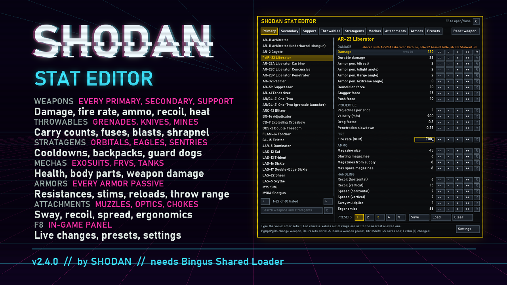

# SHODAN Stat Editor

Change the stats of weapons, throwables, stratagems, mechas, boosters, attachments, armor passives and your
helldiver in **Helldivers 2**, and transmog armor. The **Enemy Editor**
changes every enemy, your SEAF allies and how they spawn, and keeps custom difficulties as presets. **SHODAN Stat Editor
Offline** (SSEO) is a Windows program: pick a weapon, change its numbers, press **Install into the
game**, and play. It writes your values into the game's own
data files, so no mod loader is needed and the game does not have to run while you edit. Keep
setups as presets: 5 per weapon, and up to 50 named ones for everything you have changed.
English, Simplified Chinese, Traditional Chinese, Russian, Spanish (Latin America) and Portuguese (Brazil), in one program.

**[Download the latest release](../../releases/latest)** · Windows · No mod loader needed

Since game build 25988413 the in-game panel (v2.5.0 and earlier, run by Bingus Shared Loader)
no longer works; SSEO replaces it. See [In-game version](#in-game-version).



## What you can change

**Weapons**: every primary, secondary and support weapon

| Section | Stats |
|---|---|
| Damage | Damage, durable damage, fire rate, armor penetration, demolition force, stagger force, push force |
| Projectile | Projectiles per shot, velocity, drag factor, penetration slowdown |
| Explosion | Inner, outer and shockwave radius of the blast; the Breaching Hammer's explosion also has its full damage set |
| Arc | Range, chain length, chain split |
| Burning / Gas | How much fire or gas each hit applies; burn / gas damage, armor penetration and duration |
| Ammo | Infinite ammo switch; magazine size, starting magazines, magazines from supply, max spare magazines, reload time, rounds per reload and reload allowed below (clip weapons, in-game version only) |
| Handling | Recoil, spread, sway, ergonomics, aim zoom on guns with built-in sights, holster position on the back or hip |
| Spray | Flamethrowers' warm-up, pilot light, hit radius, ammo per puff and setting off mines |
| Lock-on | Lock-on range of the guns that lock on |
| Melee | Bayonet damage, armor penetration, stagger and push |
| Heat | Overheat threshold, heat per shot / per second, cool-down time, heatsinks |
| Loadout | Slot: list a primary weapon among the secondaries, or a secondary among the primaries |
| Projectile swap | The projectile the weapon fires: pick another weapon's (by name, or type its id) |
| Grenade swap | In-game version only: fire a throwable grenade, Dynamite or a throwable mine from a grenade launcher or pistol, the One-Two's launcher or the Grenadier Battlement (solo missions) |

**Burning and gas are shared.** "Burning applied per hit" belongs to the weapon; the **Burning**
(or **Gas**) section below it is the effect itself, shared by every source of it in the game,
enemies' fire included. To make one weapon burn harder, raise its own values.

**Cool-down time** is shown in seconds: how long a full heat bar takes to cool to zero. Setting it
sets the cooling rate, so raising the overheat threshold also lengthens it. The Quasar Cannon's
recharge is its "cool-down time after overheat".

**Grenade swap** (in-game version only): pick the grenade by name with - / +; 0 is the launcher's own round. The
grenade's assets load first, so the choice applies a second or two later. Ammo, fire rate and
handling stay the launcher's; edit the grenade itself on the Throwables tab. A grenade choice
takes priority over Projectile swap.

**Throwables**: every grenade, knife and throwable mine, and the shield, on the Throwables tab

| Section | Stats |
|---|---|
| Throwable | Starting count, max carried, from supply, max throw distance, fuse time (timed ones) |
| Explosion | The full damage set above, inner / outer / shockwave radius, and the burning or gas it applies |
| Shrapnel | Pieces, their damage and velocity; the G-7 Pineapple's bomblets and their explosion |
| Arc / Damage | The G-31 Arc's arc (range, chain length, split, damage); the K-2 Throwing Knife's hit |

**Stratagems**

| Stratagem | Stats |
|---|---|
| All | Cooldown, uses where limited, and the call-in code (record a new one with the arrow keys or WASD) |
| Hellpods | Items per drop: one pod can drop two weapons or packs at once |
| Eagles | Uses per rearm, Eagle rearm time, bomb pattern; time between bombs (bombers), fire duration (Strafing Run, 110mm Rocket Pods), run length |
| Orbital and Eagle strikes | For every projectile and blast they use: velocity, inner / outer / shockwave radius, and the full damage set above |
| Orbital barrages and strikes | Salvos, shells per salvo, time between shells, time between salvos, spread area, barrage delay, drift; the Walking Barrage's walking speed |
| Orbital Laser | Duration, tracking speed, search radius, damage tick |
| Guard Dogs | The drone's health, spotting range and target search interval, and the gun it carries, stat for stat like a weapon |
| Sentries and emplacements | Cooldown, health, spotting range, target search interval, turret turn speed, how far the turret can turn up, down, left and right, and their weapon stat for stat (the Tesla Tower's arc included) |
| Anti-Personnel, Anti-Tank, Gas and Incendiary Minefields | Panels and mines per panel, arming time, throw velocity and spread; the mines' trigger and chain reaction delays, their explosion's damage and radii |
| LIFT-850 Jump Pack, LIFT-860 Hover Pack | Recharge time; Jump Pack: launch force and duration, forward share of the launch, boost after the launch, mid-air steering; Hover Pack: hover time, hover speed, climb speed, acceleration and time limit |
| LIFT-182 Warp Pack | Warp distance, reach up / down, heat per warp, cooling, safe and unsafe heat, the damage an unsafe warp does to you and its explosion |
| Supply Pack, Portable Hellbomb, Guard Dogs; the ammo backpacks of the Autocannon, Recoilless Rifle, Spear, W.A.S.P., Airburst, Maxigun, Cremator and Belt-Fed GL | Backpack charges: capacity, at the start, from resupply |

**Mechas**: the exosuits, FRVs and tanks, on the Mechas tab

| Mecha | Stats |
|---|---|
| Every exosuit, FRV and tank | Cooldown, health and armor; the health and armor of every body part (legs, cockpit, tracks, doors, ...) |
| Their weapons | Each an entry of its own, stat for stat like a weapon |
| Exosuits | Walk, turn, stomp, get in and out, drop landing and stagger recovery speed (one value for all four) |
| FRVs and tanks | Handling: weight, center of mass height, engine torque, top engine speed, gears, front and rear brake strength; the wheels' grip, size, spring stiffness, damping and suspension travel |

Body parts whose names aren't known show as "Part N". The Breacher's left arm is a shield whose
hit is an ability, not a weapon stat, so it has no damage to change.

**Boosters**: the boosters whose values are in the game's data files, on the Boosters tab

| Booster | Stats |
|---|---|
| Experimental Infusion | Effect duration, movement speed and damage taken |
| Firebomb Hellpods, Stun Pods | The blast every hellpod sets off: damage, radii and its burn or stun |
| Concealed Insertion | Smoke radius |
| Dead Sprint | Health drain |
| Armed Resupply Pods | The resupply pod's turret, stat for stat like a weapon |
| Surplus EAT Allocation | Uses of the extra EAT |

**Attachments**: optics, underbarrels, muzzles and ammunition types, on the Attachments tab

| Attachment | Stats |
|---|---|
| Optics, underbarrels, muzzles (weapons' own Custom muzzle brakes included), shotgun chokes | Ergonomics bonus, and where the attachment has them: sway, recoil, climb and spread multipliers; an optic's zoom levels and zeroing distances |
| Ammunition types (alternate loads included), by their names in game | Recoil and spread multipliers |

An attachment's values apply to every weapon fitted with it (an ammunition type's, to every
weapon loaded with it).

**Armor passives**: every one, on the Armors tab

| Passive | Stats |
|---|---|
| Every armor passive | Every value it has: damage taken from explosions, fire, gas, arc, impacts and to the chest; extra stims and throwables; stim duration; reload speeds; ammo capacity; throw range; melee damage; limb health; noise and detection range; armor rating and ergonomics bonuses; and the weapon stat values some passives carry |

Multipliers show as the game stores them: 1 is no change, 0.5 damage taken is 50% resistance,
1.3 reload speed is 30% faster. A passive's values apply to every armor that has it.

### Transmog

Give any armor up to 14 passives, or none, so you can wear the look you want with
the passives you want. Every armor has its own page on the Armors tab:

- **+ Add passive** picks one from a list; **Remove** takes it off; **Open** goes to its page.
- It changes only that armor, and every armor set with that name.
- A passive brings every effect it has (Engineering Kit: its grenades and its recoil reduction), at
  the values set on its own page. The passive pages are below the armors.
- With several passives the armory shows the first one's name and at most 3 effects. All of them
  apply. Two passives with the same effect count it once.
- **Reset armor** puts its passive, name and description back to the game's.

**Armor weight**: on the Armors tab, make any armor light, medium or heavy. Speed and stamina
follow the weight you pick.

**Helldiver**: first on the Armors tab: health, each body part's health, movement speeds and
stamina, melee and bayonet strikes, what a hit to the head costs, the sway of every weapon at once, and
suppression: how close enemy fire must pass to shake your aim. It changes every helldiver in your game: restore the game's files before joining other
players' lobbies.

### Explosions and records

- Each shot's **Impact explosion** and **Expiry explosion** can be any explosion of the game, or
  none (0), with its **Blast proximity** (a flak fuse) and **Blast delay**; each explosion's
  **Shrapnel** can be any projectile. These rows are at the bottom of a weapon page.
- The **Records** tab lists every projectile, explosion and status record of the game, named after
  the game's rounds and the weapons using them. The explosion rows on a weapon page stay its own
  explosion's: edit a newly chosen one here.

## Enemy Editor

Make your own difficulty. Click **SHODAN Enemy Editor** at the top left: the window turns red and
edits the enemies instead; **SHODAN Stat Editor** switches back. One Install puts the changes of
both editors in the game. Its tabs are Terminids, Automatons, Illuminate, SEAF and Spawning.

| Page | Stats |
|---|---|
| Every enemy | Health, armor, durable ratio, explosive damage taken, bleed-out health and regeneration; each body part's health, armor and bleed-out, and whether destroying it kills the enemy |
| Behavior | Animation speed, with attacks and stagger recovery each on their own (faster attack animations make attacks come out sooner); movement speed for each behaviour, from patrolling to charging; which side it fights for; size, sight range and cone, hearing, how long it keeps tracking you after losing sight, stagger resistance, stun and gas resistance, and the fire, acid, electric and gas damage it takes |
| Suppression | How hard your fire throws off its aim, how long its aim takes to steady, and how close your shots must land |
| Attacks | Each melee attack's damage, armor penetration, stagger and push; the explosion it sets off when it dies |
| Enemy weapons | Each gun listed under its enemy, stat for stat like a weapon: damage, armor penetration, explosion, projectile speed, fire rate, magazine and spread |
| Shields and jamming | Shield capacity and recharge; the jamming radius of Stratagem Jammers, Command Bunkers and AA Emplacements; the scrambling radius of Cognitive Disruptors; the Leviathan's flight height; the Warp Ship, Warp Gateway and Infested Tower, and how much force destroys a structure |
| SEAF | Every SEAF soldier kind, stat for stat like an enemy, with its weapons; the weapons each kind carries, from the ones the game has for SEAF |
| All Terminids, All Automatons, All Illuminate, All SEAF | One row for the whole faction: health, armor, damage, movement speed, sight, weapon spread, suppression, stagger resistance, stun and gas resistance, fire damage taken |
| Spawning | Per faction: reinforcement size and frequency, or none at all; the cap on enemies at once; patrol frequency and patrols at once; modifier patrols; outpost garrison size; Fabricator and bug hole output |
| All factions | The lowest patrol and reinforcement rates the game allows, and SEAF reinforcement and wave cooldowns |

**Custom difficulties.** The Enemy Editor's **Presets** hold only enemy and spawning values, apart
from the Stat Editor's: loading a difficulty leaves your weapons as they are, and loading a weapon
setup leaves the enemies. It comes with **Default** (the game's own values), **Horde**, **Glass
Cannon** and **Elite**; change them, delete them or add your own. They are saved as
`enemy_preset_01.txt` … next to config.txt, to share like full presets. **Restore built-in presets**
in Settings puts the four back as they came.

- A faction row leaves alone every enemy you have changed by hand, so a difficulty can raise a
  whole faction and still tune single enemies.
- Some values are shared: a melee attack, gun or death explosion used by several enemies changes
  for all of them.
- Spawn values are multipliers of the game's own (1 is no change). A very high enemy cap can make
  the game stutter or crash.

## Install

1. Download `SHODAN-Stat-Editor-Offline-v<version>.zip` from the [releases page](../../releases/latest) and
   unzip it anywhere (keep the files together).
2. Close Helldivers 2 and start **SHODAN Stat Editor Offline.exe**. It finds the game through Steam;
   if it cannot, write your Helldivers 2 folder's path into
   `%LOCALAPPDATA%\SHODAN\StatEditor\game folder.txt` and start it again.
3. Change values, press **Install into the game**, then start the game.

**Restore the game's files** puts the files back as they were before SSEO (the game's own, or
another mod's); your values stay saved, and Install
puts them in again. After a game update or Steam's "Verify integrity of game files" the game's own
files are back: start SSEO and press Install again.

**Updates.** From v3.1.0 SSEO asks GitHub for its latest release at start. When there is a newer
one, **Update to v…** appears at the top right: one click downloads it, swaps the new files in
and restarts. Your values, presets and the game's originals stay as they are. (v3.0.0 has no
updater: download the latest release once by hand.)

Windows SmartScreen or an antivirus may warn about the program the first time (it is not signed).

## Use

The window is the panel: click, or use the keys. Drag its edges to resize it; it keeps its shape and
remembers its size.

| Key | Action |
|---|---|
| Up / Down | Choose a stat |
| Left / Right | Change it (hold Shift for bigger steps) |
| Enter, or click a value | Type the value (Enter sets it, Esc cancels) |
| PgUp / PgDn | Previous / next weapon |
| Ctrl+F | Search (or click the box under the list) |
| Del | Reset the stat to the game's value |
| Ctrl+1–5 / Ctrl+Shift+1–5 | Load / save a weapon preset |

**Typing values.** Click a number (or press Enter on a stat) and type: digits, and "." or ","
for decimals. Enter sets it, Esc cancels, and clicking elsewhere also sets it. A value outside
what the stat can take is set to the nearest allowed one, and the panel says so.

Every change is saved to

```
%LOCALAPPDATA%\SHODAN\StatEditor\config.txt
```

with your presets. The game gets them when you press **Install into the game** (with the game
closed: it reads its files when it starts). The bar at the bottom says whether your values are in
the game.

**Names and descriptions.** Weapons, throwables, stratagems, armors, helmets, capes, passives,
attachments and boosters have Name and Description boxes at the bottom of their pages, and each passive
on an armor's page has a text box of its own. Click one, type, and press Enter; R puts the game's own text back. Press
Shift+Enter in a description for a new line, twice for a blank line
between paragraphs. In passive text, `#BONUS` shows the passive's value and each paragraph keeps its
own. Install puts your text in the game, in every language.

## Settings

The **Settings** button at the bottom right opens its options:

- **Language**: English, Simplified Chinese, Traditional Chinese, Russian, Spanish (Latin America) or
  Portuguese (Brazil).
- **Apply my changes**: turn it off (then Install) to play with the game's own values; your
  changes are kept and come back when you turn it on.
- **Remember last tab and weapon**.
- **Updates**: **Ask** (the Update button; the default) or **Automatic** (updates at start
  without asking).
- **Update channel**: **Releases** (tested versions; the default) or **Every commit**: the
  [Development build](../../releases/tag/dev), built automatically from every change pushed to
  this repository, before it is tested. It may break; switch back to Releases to get the next
  tested version.
- **Tabs shown**: hide the tabs you do not use (their items leave the search too).
- **Several vehicles of a kind**: off by default; on, a loadout can take more than one exosuit, FRV or tank.
- **Sniper crosshair in third person**: off by default; on, sniper rifles show a crosshair when you aim in
  third person.
- **Reset all values**: every change of the current setup back to the game's values (asks
  "Sure?" first; click again to confirm).
- **Restore built-in presets**: puts the Enemy Editor's built-in presets back as they came; your own
  presets stay.

The page also has the version, a link to this page and **Logs and Presets**, which opens the
`%LOCALAPPDATA%\SHODAN\StatEditor` folder.

## Search

Click the box under the weapon list (or press Ctrl+F) and type: the list shows the weapons and
stratagems of every tab whose name holds all the words typed ("orb las" finds the Orbital
Laser). On the Records tab it searches the records. The **\*** button next to the box lists only
what you have changed, from every tab. Enter keeps the results; Esc or **X** clears
the search.

## Presets

**Weapon presets.** Every weapon and stratagem has 5. Use the PRESETS strip under its stats:
pick a number, then **Save** (its current values), **Load** or **Clear**. Numbers in gold hold a
preset. Loading one sets the weapon exactly as saved; anything the preset doesn't name goes back
to the game's value.

**Full presets.** Up to 50, under the **Presets** button (left of Settings), each with a name you choose and every change
you have made.

- **+ New preset** saves your current changes as one, then you type its name (Enter keeps it,
  Esc cancels).
- **Load** replaces all current changes with the preset. **Save current changes here**,
  **Rename** and **Delete** work on the chosen one; overwriting and deleting ask twice.
- Keyboard there: Up/Down choose, Enter loads, Insert makes a new one, Shift+Insert saves
  into the chosen one, F2 renames, Del deletes.

Presets are saved next to config.txt, as `weapon_presets.txt` and `preset_01.txt` …
`preset_50.txt`. A full preset file can be copied into another player's `StatEditor` folder to
share the whole setup.

## Good to know

- **Shared values.** Some weapons fire the same projectile or share its damage values (for
  example the Liberator, Liberator Carbine, StA-52 and Stalwart). The panel names the weapons
  that change along with the one you edit.
- **Projectile swap.** A weapon firing another weapon's projectile deals that projectile's damage
  and flies like it; fire rate, ammo and handling stay its own. To tune those shots, edit the
  other weapon's values (they change for both).
- **Variants.** Some weapons exist more than once in the game's data (a mounted copy, an
  underbarrel attachment). The list labels each one, and the panel says which copy
  you are editing.
- **Barrages** can use different shells for different rounds; the section names say which rounds
  a value belongs to. Long lists scroll: Up/Down follow the chosen stat, or use the buttons under
  the list.
- **Each magazine is edited on its own.** Weapons with several magazines or heatsinks list each
  one in a section of its own (size, spare magazines, reload time, heat, ergonomics bonus);
  changing one leaves the others as they are. A magazine some other weapons also use is shared
  with them, and its section names them. Values saved by older versions for the whole weapon
  carry over to its magazines.
- **Magazines hold at most 2048 rounds.** The game caps a magazine there (a bigger one drops to
  2048 at the first shot), so the editor stops at 2048 and says so if you go past it.
- **Custom muzzle brakes.** Seven weapons come with a muzzle brake of their own (Liberator
  Penetrator, Pacifier, Coyote, Adjudicator, Tenderizer, Hyena, Diligence Counter Sniper). Each is
  an entry on the Attachments tab, named after its weapon ("Muzzle brake (Liberator Penetrator)").
- **In multiplayer** your changes exist only in your game.
- **Other mods.** SSEO should work alongside mods that change the same game files (other stat or
  stratagem tools) without conflict, as long as they go in first: SSEO keeps their changes and
  adds yours on top. This is not thoroughly tested yet.
  1. Install or apply the other mod.
  2. Start SSEO and press Install.
  3. To change or remove the other mod later, press Restore in SSEO first, change the other mod,
     then press Install in SSEO again.

  Where both change the same stat, SSEO's value wins.
- **SSEO changes the game's data files.** The changed files keep the checksum the game expects,
  and the originals are kept in `%LOCALAPPDATA%\SHODAN\StatEditor\originals` (Restore puts them
  back). Use it at your own risk, and keep to private games with friends if in doubt.
- **Projectile swap** works offline, but a swapped projectile has its trail only if someone in
  the mission carries the weapon it comes from. Arc chain length / split edits also apply with
  other players.
- **One extra file.** Vehicle handling, exosuit movement, enemy animation speed and your names and
  descriptions go into one extra file in the game's `data` folder (`9ba626afa44a3aa3.patch_N`), which
  the game loads over its own files. Restore removes it.
- **Game Updates** might require you to use the "Restore the game's files" option and then 
  "Install into the game" again, otherwise your game may fail to connect to EAC.

## Reporting problems

Open an [issue](../../issues) and attach the logs (Settings > Logs and Presets opens their folder):

```
%LOCALAPPDATA%\SHODAN\StatEditor\Logs\SHODANStatEditor.log
%LOCALAPPDATA%\SHODAN\StatEditor\Logs\SHODANStatEditorHost.log
```

The logs list the game files and tables SSEO found, every stratagem it listed, what Install
wrote, and anything it could not match, which is usually enough to find the cause.

## In-game version

Versions up to v2.5.0 were an in-game panel (F8) run by **Bingus Shared Loader**, changing the
game's settings in memory while it ran. Game build 25988413 removed what it needed, so it no
longer works; SSEO edits the same values in the game's files instead. Grenade swap, speedloader /
clip sizes and unlocking unused items (M-104 Incinerator FRV, P-41 Ombudsman, G-11 Caltrops,
LAS-22 Shear) need the running game and exist only there. `src/stat_editor.lua` is the in-game
version's source.

## Building from source

`offline/` holds SSEO: `host.lua` (the program), `engine_shim.lua` (its window), `gamedata.lua`
(reading and sealing the game's data files), `install.lua` (Install / Restore), `update.lua` (the
updater) and `launcher/` (the .exe, and `shodan_hash.dll` for the checksums and downloads). The
panel is `src/stat_editor_offline.lua`.

1. Build [LuaJIT](https://luajit.org) 2.1 (`msvcbuild.bat`), then `offline\launcher\build.bat`
   with `LJ` set to LuaJIT's `src` folder (Visual Studio 2022 Build Tools).
2. Put `lua51.dll` (LuaJIT) and `libsodium.dll` ([libsodium](https://libsodium.org), x64) in
   `offline\runtime\`.
3. `python offline\package.py` makes the release zip in `offline\release\`.

`.github/workflows/dev-build.yml` does the same on GitHub for every push to `main` and publishes
the result as the Development build pre-release.

## Credits

- **Bingus Shared Loader** by CowboyBingus, which runs the in-game version.
- **[LuaJIT](https://luajit.org)** (MIT) and **[libsodium](https://libsodium.org)** (ISC), which SSEO
  ships: their licences are in the release's THIRD-PARTY-NOTICES.txt.
- **HD2Runtime** by Skyeshade, whose weapon, stratagem and enemy catalogs name the weapons and
  enemies and map every strike to its projectiles, blasts and damage, and whose research locates
  package loading and the live entity and unit layouts that Grenade swap uses.
- **Gameplay Reforged: Recovery Edition** by SweetSwallow and **Little Enemy Kontrol** by Nappleon,
  whose enemy and spawn edits showed where those values live.
- **[Filediver](https://github.com/xypwn/filediver)** and the **[helldivers.io](https://helldivers.io/)**
  data dump by shalzuth, for the game's data layouts and the armor passives.
- The **[Helldivers 2 wiki](https://helldivers.wiki.gg/)**, whose passive descriptions name every
  armor passive value.
- **DiverKit** and **HD2 HUD Plus**, which showed where the game's UI font lives.

## License

[GNU General Public License v3.0](LICENSE). You can use, change and share it, but anything
you distribute that is based on it must also be released under the GPL v3 with its source.

SHODAN Stat Editor is not affiliated with or endorsed by Arrowhead Game Studios or Sony
Interactive Entertainment.
